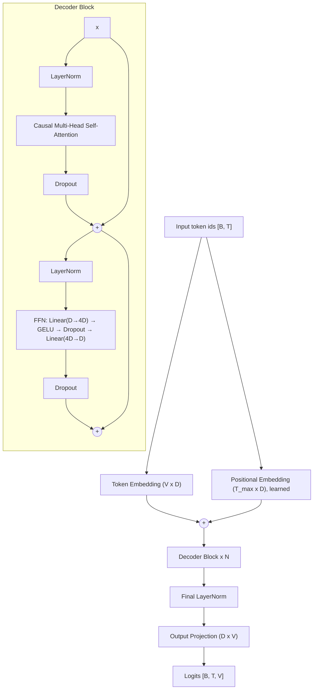

# Distributed Training of a Decoder-Only Transformer — 4D Parallelism from Scratch

> Training a GPT-style language model with **FSDP (Data Parallel) + Pipeline Parallel + Tensor Parallel + Sequence Parallel**, built directly on native PyTorch distributed primitives (`DeviceMesh`, `DTensor`, `fully_shard`, `torch.distributed.pipelining`).

---

## Table of Contents

- [Project Goal](#project-goal)
- [Highlights](#highlights)
- [Repository Structure](#repository-structure)
- [Model Architecture](#model-architecture)
- [Dataset & Tokenizer](#dataset--tokenizer)
- [Parallelism Strategy](#parallelism-strategy)
  - [Device Mesh](#1-device-mesh)
  - [Pipeline Parallelism (PP)](#2-pipeline-parallelism-pp)
  - [Tensor Parallelism (TP)](#3-tensor-parallelism-tp)
  - [Sequence Parallelism (SP)](#4-sequence-parallelism-sp)
  - [Fully Sharded Data Parallel (FSDP)](#5-fully-sharded-data-parallel-fsdp)
  - [Loss Parallel](#6-loss-parallel)
  - [Order of Composition](#7-order-of-composition)
- [Training Pipeline](#training-pipeline)
- [Installation](#installation)
- [Quick Start](#quick-start)
- [Configuration](#configuration)
- [Checkpoints & Inference](#checkpoints--inference)
- [Parallelism Constraints](#parallelism-constraints)
- [Experiment Tracking (W&B)](#experiment-tracking-wb)
- [Troubleshooting](#troubleshooting)
- [Limitations & Roadmap](#limitations--roadmap)
- [References](#references)

---

## Project Goal

**This project is about training a neural network with distributed training. It is not about getting state-of-the-art model quality.**

The model is a small, plain decoder-only Transformer with learned token embeddings and learned positional embeddings. I kept it simple on purpose so the focus stays on the parallelism:

- how to split one model across many GPUs along **four separate dimensions**,
- how activations and gradients move between devices,
- how the parallelism strategies **compose** without stepping on each other.

Every technique here (FSDP, PP, TP, SP, Loss Parallel) is the same one used to train large production LLMs. Here they are applied to a model small enough to follow from end to end.

---

## Highlights

| Feature | Implementation |
|---|---|
| **Data Parallel** | FSDP2 (`torch.distributed.fsdp.fully_shard`): parameters, gradients and optimizer states sharded across DP ranks |
| **Pipeline Parallel** | `torch.distributed.pipelining` with the **GPipe** schedule and micro-batching |
| **Tensor Parallel** | Megatron-style column/row sharding of Attention and FFN projections via `parallelize_module` |
| **Sequence Parallel** | LayerNorms, dropout and residuals run on **sequence-sharded** activations |
| **Loss Parallel** | Cross-entropy computed directly on **vocab-sharded** logits; full logits are never gathered |
| **Device Mesh** | 3D `DeviceMesh` `(pp, dp, tp)`, with sizes set by environment variables |
| **Grad clipping** | Global grad-norm clipping across DP, TP **and** PP stages |
| **LR schedule** | Linear warm-up followed by cosine annealing |
| **Checkpointing** | Sharded weights gathered and merged into one plain `state_dict`, loadable on a single device |
| **Hardware** | Runs on **NVIDIA GPUs (NCCL)** or **CPU (Gloo)** with no code changes |

---

## Repository Structure

```
Distributed Training/
├── Transformer/                    # Model architecture, data pipeline, single-device baseline
│   ├── configs.py                  # All hyper-parameters (model, optimizer, schedule)
│   ├── token_embedding.py          # Token embedding + learned positional embedding
│   ├── attention.py                # Multi-head causal self-attention (with padding mask)
│   ├── ffnn.py                     # Position-wise feed-forward network (GELU)
│   ├── decoder.py                  # Pre-LN decoder block (Attention + FFN + residuals)
│   ├── transformer.py              # Full model + autoregressive generation (top-p sampling)
│   ├── prepare_dataset.py          # Loads raw text; trains the BPE tokenizer when run directly
│   ├── dataloader.py               # Tokenises the corpus into (input, target, mask) samples
│   ├── cosine_annealing.py         # Warm-up + cosine LR multiplier for LambdaLR
│   ├── main.py                     # Single-device (CPU/GPU) training baseline
│   ├── inference.py                # Load weights and generate text
│   ├── get_wandb_run.py            # Optional Weights & Biases logging
│   ├── check.py                    # Tokenizer sanity check
│   ├── my_tokenizer/               # Trained BPE tokenizer (vocab = 1200)
│   └── data/train/dataset.txt      # Training corpus (Wikipedia text)
│
├── TrainingParallelism/            # Distributed training (the core of this project)
│   ├── utils.py                    # Process-group init + 3D DeviceMesh construction
│   ├── main.py                     # FSDP + PP + TP + SP + Loss-Parallel training loop
│   └── checkpoints/                # Created at runtime: stage_*.pt + merged weight.pth
│
├── requirements.txt
└── README.md
```

### `Transformer/`: the model

Everything needed to define, train and sample from the model **on a single device**. The distributed code imports the model from here unchanged. The parallelism is applied *from outside*, so the architecture code has no distributed logic in it, apart from one line that infers the attention output width so sharded heads work.

### `TrainingParallelism/`: the distributed engine

Takes the plain `Transformer` and:

1. builds a 3D device mesh,
2. **cuts** it into pipeline stages,
3. **shards** each stage with Tensor + Sequence Parallel,
4. **wraps** each stage with FSDP,
5. drives training with a GPipe pipeline schedule under Loss Parallel.

---

## Model Architecture

A vanilla **decoder-only (GPT-style) Transformer** with **Pre-LayerNorm** blocks.



| Component | Details |
|---|---|
| Embeddings | Learned token embedding + learned absolute positional embedding (summed) |
| Attention | Multi-head scaled dot-product, **causal mask** combined with a **padding mask** |
| Feed-forward | `Linear(D, 4D) → GELU → Dropout → Linear(4D, D)` |
| Normalisation | Pre-LN (`LayerNorm` before attention and FFN) + final `LayerNorm` |
| Residuals | Residual connection with dropout around each sub-layer |
| Init | `N(0, 0.02)` for Linear/Embedding weights, zero biases, unit LayerNorm |

### Default hyper-parameters (`Transformer/configs.py`)

| Parameter | Value |
|---|---|
| `hidden_dim` (D) | 128 |
| `n_heads` | 4 (head dim = 32) |
| `n_layers` | 8 |
| `max_seq_len` (T) | 256 |
| `vocab_size` (V) | 1200 |
| Dropout (attn / ffn / resid) | 0.01 |
| Batch size (per micro-batch) | 64 |
| Optimizer | AdamW |
| LR | 5e-3 → 5e-4 (cosine), 150 warm-up steps |
| Grad clip | 1.0 |
| Epochs | 150 |
| **Total parameters** | **≈ 1.93 M** |

---

## Dataset & Tokenizer

- **Source:** English text **scraped from Wikipedia**, stored as one plain-text file at `Transformer/data/train/dataset.txt`.
- **Size:** about **718293 tokens**, which is about **9.9 K training sequences** of 256 tokens.
- **Tokenizer:** a **byte-level BPE** tokenizer trained on this corpus, starting from GPT-2's tokenizer setup (`train_new_from_iterator`):
  - vocabulary size **1200** (1198 learned + `[PAD]` + `[BOS]`)
  - EOS / UNK token: `<|endoftext|>`
  - saved in `Transformer/my_tokenizer/`

### How samples are built (`dataloader.py`)

1. The whole corpus is tokenised into one stream.
2. The stream is padded to a multiple of `max_seq_len` (+1 token for the shift).
3. It is cut into non-overlapping windows:
   - `inputs  = ids[i : i+T]`
   - `targets = ids[i+1 : i+1+T]` (next-token prediction)
4. Padding positions get `targets = -100` (ignored by the loss) and `attn_mask = 0`.

To retrain the tokenizer:

```bash
cd Transformer
python prepare_dataset.py
```

---

## Parallelism Strategy

### 1. Device Mesh

All parallelism is described by one 3D **`DeviceMesh`** with named dimensions `("pp", "dp", "tp")`:

- **TP is innermost**, so TP ranks are neighbours. TP does the most communication (several collectives per layer), so it belongs on the fastest link (NVLink, same node).
- **PP is outermost.** It only sends point-to-point activations between stages, which is the least bandwidth-sensitive traffic.

Example with **8 GPUs** (`PP=2, DP=2, TP=2`): `rank = pp·4 + dp·2 + tp`

```
                    Pipeline Stage 0                    Pipeline Stage 1
               (Embedding + Layers 0–3)          (Layers 4–7 + LN + Output Head)
             ┌──────────────────────────┐       ┌──────────────────────────┐
  DP replica │  TP group: GPU0 ─ GPU1   │ ───▶  │  TP group: GPU4 ─ GPU5   │
      0      └──────────────────────────┘       └──────────────────────────┘
             ┌──────────────────────────┐       ┌──────────────────────────┐
  DP replica │  TP group: GPU2 ─ GPU3   │ ───▶  │  TP group: GPU6 ─ GPU7   │
      1      └──────────────────────────┘       └──────────────────────────┘

  TP groups : (0,1) (2,3) (4,5) (6,7)    → split each layer's weights
  DP groups : (0,2) (1,3) (4,6) (5,7)    → FSDP sharding + gradient reduce-scatter
  PP groups : (0,4) (1,5) (2,6) (3,7)    → send/recv activations between stages
```

The DP size is derived automatically: `DP = WORLD_SIZE / (TP × PP)`.

| GPUs | TP | PP | DP |
|---|---|---|---|
| 4 | 2 | 2 | 1 |
| 8 | 2 | 2 | 2 |
| 16 | 2 | 2 | 4 |
| 8 (`PP_SIZE=4`) | 2 | 4 | 1 |

---

### 2. Pipeline Parallelism (PP)

The model is **split by depth** into `PP` stages:

| Stage | Contents |
|---|---|
| First | Token + positional embedding, layers `[0 … N/PP)` |
| Middle | Layers only |
| Last | Layers `[… N)`, final LayerNorm, output projection, loss |

- Implemented with `torch.distributed.pipelining.PipelineStage`. Shapes are inferred at runtime, so no example inputs are needed.
- Uses the **GPipe** schedule (`ScheduleGPipe`): each batch of `batch_size × N_MICRO_BATCHES` sequences is split into **micro-batches**. Every micro-batch goes through all forward passes, then all backward passes, and gradients are accumulated.
- `attn_mask` is passed as a keyword argument and is split into micro-batches automatically, so every stage receives the mask for its current micro-batch.

---

### 3. Tensor Parallelism (TP)

Within each stage, the weights of every layer are **split across the TP group** (Megatron-LM style). Plans are applied with `parallelize_module`:

| Module | TP style | Effect |
|---|---|---|
| `token_embedding`, `position_embedding` | `RowwiseParallel` (input Replicate → output `Shard(1)`) | Embedding table sharded over the vocab/position dim; output reduce-scattered into **sequence shards** |
| `attention.q_proj / k_proj / v_proj` | `ColwiseParallel` | Each rank computes **`n_heads / TP` heads** |
| `attention.out_proj` | `RowwiseParallel` (output `Shard(1)`) | Partial sums **reduce-scattered** back to sequence shards |
| `ffnn.fc1` | `ColwiseParallel` | Hidden `4D` dim sharded |
| `ffnn.fc2` | `RowwiseParallel` (output `Shard(1)`) | Reduce-scatter back to sequence shards |
| `output_proj` | `ColwiseParallel` (output `Shard(-1)`) | Logits stay **sharded over the vocabulary** |

Splitting attention heads works because each rank sets `num_heads = n_heads // TP` before the plan is applied. Heads are independent, so no communication is needed inside the attention computation itself.

---

### 4. Sequence Parallelism (SP)

TP alone would leave LayerNorm, dropout and residual additions **replicated**: every TP rank holds the full `[B, T, D]` activation. SP removes that duplication.

- `attn_norm`, `ffnn_norm` and the final `layernorm` use `SequenceParallel()`, so they run on activations **sharded along the sequence dim** (`[B, T/TP, D]`).
- Before attention / FFN, `PrepareModuleInput` **all-gathers** the sequence (`Shard(1) → Replicate`), because attention needs every token.
- After the row-parallel projection, a **reduce-scatter** returns the activations to sequence shards.

Each layer's data flow on one TP rank:

```
[B, T/TP, D] ──LayerNorm (SP)──▶ all-gather ──▶ [B, T, D]
     │                                              │
     │                              Q/K/V (col-parallel, n_heads/TP heads)
     │                                              │
     │                               causal attention on full sequence
     │                                              │
     │                             out_proj (row-parallel) ─▶ reduce-scatter
     │                                              │
     └────────────── residual add ◀── [B, T/TP, D] ◀┘
```

The activations passed between pipeline stages are also sequence-sharded, which cuts PP communication by a factor of `TP`.

---

### 5. Fully Sharded Data Parallel (FSDP)

- Uses **FSDP2** (`fully_shard`) on the `dp` mesh dimension.
- Every decoder block is wrapped separately, then the stage root is wrapped. **Parameters, gradients and AdamW states** are sharded across DP ranks.
- FSDP composes with TP: parameters that are already TP-sharded `DTensor`s are sharded a second time over DP, giving a 2D `(dp, tp)` layout.
- `reshard_after_forward=False` keeps parameters gathered between forward and backward. This avoids re-gathering them for every micro-batch in the pipeline.
- `DistributedSampler` gives each DP replica a different slice of the data. All TP and PP ranks inside one replica see the **same** batch.

---

### 6. Loss Parallel

With `output_proj` sharded over the vocabulary, gathering the full `[B, T, V]` logits on every rank would waste memory and bandwidth. Instead, training runs under `torch.distributed.tensor.parallel.loss_parallel()`:

- cross-entropy is computed **directly on vocab-sharded logits**,
- only small per-token statistics (max, sum-exp) are communicated.

---

### 7. Order of Composition

The order matters. `TrainingParallelism/main.py` applies the strategies like this:

```
Transformer()                           # full model on every rank (same seed → identical weights)
  │
  ├─ 1. Pipeline split                   # keep only this stage's layers / embedding / head
  ├─ 2. Tensor + Sequence Parallel       # parallelize_module on the tp mesh
  ├─ 3. FSDP                             # fully_shard on the dp mesh
  ├─ 4. PipelineStage + ScheduleGPipe    # wrap the sharded stage
  └─ 5. AdamW + warm-up/cosine LambdaLR
```

---

## Training Pipeline

For each step:

1. Every rank loads the same DP-shard batch of `batch_size × N_MICRO_BATCHES` sequences.
2. `schedule.step(...)` runs the GPipe forward and backward over all micro-batches inside `loss_parallel()`:
   - the **first stage** gets `input_ids`,
   - the **last stage** gets `targets` and collects per-micro-batch losses.
3. **Global gradient clipping:**
   - the grad norm is reduced over DP/TP (DTensor),
   - then all-reduced over PP stages,
   - then gradients are scaled to `max_grad_norm`.
4. `optimizer.step()` and `scheduler.step()`.
5. A single rank (last stage, `tp=0`, `dp=0`) logs the loss and perplexity.
6. Every 10 epochs and at the end, a merged checkpoint is written.

---

## Installation

**Requirements:** Python ≥ 3.11, PyTorch ≥ 2.6. NVIDIA GPUs with NCCL are recommended; CPU works for functional testing.

```bash
git clone <your-repo-url>
cd "Distributed Training"

python -m venv venv
source venv/bin/activate          # Windows: venv\Scripts\activate

pip install -r requirements.txt
```

For GPUs, install the CUDA build of PyTorch that matches your driver (see [pytorch.org](https://pytorch.org/get-started/locally/)).

---

## Quick Start

All distributed runs are launched with **`torchrun`** from the repository root.

### 8 GPUs (PP=2 × DP=2 × TP=2)

```bash
torchrun --nproc_per_node=8 TrainingParallelism/main.py
```

### 4 GPUs (PP=2 × DP=1 × TP=2)

```bash
torchrun --nproc_per_node=4 TrainingParallelism/main.py
```

### Custom layout (for example 8 GPUs as PP=4 × TP=2)

```bash
PP_SIZE=4 TP_SIZE=2 torchrun --nproc_per_node=8 TrainingParallelism/main.py
```

### Multi-node (2 nodes × 8 GPUs)

```bash
# on every node
torchrun --nnodes=2 --nproc_per_node=8 \
         --rdzv_backend=c10d --rdzv_endpoint=<MASTER_IP>:29500 \
         TrainingParallelism/main.py
```

On multiple nodes, the checkpoint merge step needs a **shared filesystem**. See [Checkpoints](#checkpoints--inference).

### CPU (functional test, no GPU needed)

The same command works on a machine without CUDA. The **Gloo** backend is selected automatically:

```bash
torchrun --nproc_per_node=4 TrainingParallelism/main.py
```

### Single-device baseline (no parallelism)

```bash
cd Transformer
python main.py
```

---

## Configuration

### Environment variables (distributed run)

| Variable | Default | Description |
|---|---|---|
| `TP_SIZE` | `2` | Tensor-parallel (and sequence-parallel) degree |
| `PP_SIZE` | `2` | Number of pipeline stages |
| `N_MICRO_BATCHES` | `4` | GPipe micro-batches per step (should be ≥ `PP_SIZE`) |
| `WANDB_API_KEY` | unset | Only needed if W&B logging is enabled |

`DP` is always `WORLD_SIZE / (TP_SIZE × PP_SIZE)`.

### Model / optimisation hyper-parameters

Edit `Transformer/configs.py`. Batch-size terms:

- **Micro-batch** = `batch_size` (64)
- **Per-DP-replica batch per step** = `batch_size × N_MICRO_BATCHES` (256)
- **Global batch per step** = `batch_size × N_MICRO_BATCHES × DP`

---

## Checkpoints & Inference

The distributed run writes the following to `TrainingParallelism/checkpoints/`:

| File | Contents |
|---|---|
| `stage_{k}.pt` | Full (un-sharded) weights of pipeline stage `k`, with layer indices remapped to global indices |
| `weight.pth` | All stages merged into a single standard `state_dict` |

`weight.pth` loads directly into a regular, non-distributed `Transformer`:

```bash
cd Transformer

# weights from distributed training
python inference.py ../TrainingParallelism/checkpoints/weight.pth

# weights from the single-device baseline (Transformer/weight.pth)
python inference.py
```

Generation uses temperature scaling and **nucleus (top-p) sampling**. Prompt plus generated length is capped at `max_seq_len`.

---

## Parallelism Constraints

These are checked at startup, so a bad configuration fails immediately with a clear message:

| Constraint | Default values |
|---|---|
| `n_heads % TP == 0` | 4 heads → TP ∈ {1, 2, 4} |
| `hidden_dim % TP == 0` | 128 |
| `max_seq_len % TP == 0` | 256 (needed for sequence sharding) |
| `vocab_size % TP == 0` | 1200 |
| `n_layers % PP == 0` | 8 layers → PP ∈ {1, 2, 4, 8} |
| `WORLD_SIZE % (TP × PP) == 0` | — |
| `N_MICRO_BATCHES ≥ PP` | 4 |
| Dataset must give ≥ 1 batch per DP rank | ~9.9K sequences |

---

## Experiment Tracking (W&B)

Logging to Weights & Biases is **optional and off by default**. The distributed script doesn't use W&B at all.

To enable it for the single-device baseline:

1. Set `log_to_wandb = True` in `Transformer/main.py`.
2. Provide **your own** API key:
   ```bash
   export WANDB_API_KEY=<your-key>     # or: wandb login
   ```

API keys are never stored in the repository.

---

## Troubleshooting

| Symptom | Cause / Fix |
|---|---|
| `AssertionError: world_size=... must be divisible by TP_SIZE*PP_SIZE` | Choose `--nproc_per_node` as a multiple of `TP_SIZE × PP_SIZE` |
| `n_heads=4 must be divisible by TP=8` | Lower `TP_SIZE`, or raise `n_heads` in `configs.py` |
| `Dataloader is empty` | Too many DP replicas for the dataset size. Lower `batch_size` / `N_MICRO_BATCHES` or use fewer DP ranks |
| `KeyError: 'LOCAL_RANK'` | The script was run with `python`. Launch it with `torchrun` |
| NCCL hangs on multi-node | Check `--rdzv_endpoint`, firewall ports and `NCCL_SOCKET_IFNAME` |
| Very slow on CPU | Expected. CPU mode is for checking correctness, not speed |

---

## Limitations & Roadmap

This is a learning-focused implementation. Known gaps and possible next steps:

- [ ] **Mixed precision** (bf16 via FSDP `MixedPrecisionPolicy`)
- [ ] **Activation checkpointing** for larger models
- [ ] **Interleaved 1F1B** pipeline schedule to shrink the pipeline bubble
- [ ] **Context Parallelism** for longer sequences
- [ ] **Validation loop** and evaluation metrics
- [ ] **Resumable checkpoints** (optimizer + scheduler state via `torch.distributed.checkpoint`)
- [ ] **Streaming / pre-tokenised dataset** (currently every rank tokenises the full corpus at start-up)
- [ ] Modern architecture options (RoPE, RMSNorm, SwiGLU), kept out on purpose to keep the focus on parallelism

---

## References

- Shoeybi et al., *Megatron-LM: Training Multi-Billion Parameter Language Models Using Model Parallelism* (2019)
- Korthikanti et al., *Reducing Activation Recomputation in Large Transformer Models* (Sequence Parallelism, 2022)
- Huang et al., *GPipe: Efficient Training of Giant Neural Networks using Pipeline Parallelism* (2019)
- Zhao et al., *PyTorch FSDP: Experiences on Scaling Fully Sharded Data Parallel* (2023)
- PyTorch docs: [Tensor Parallel](https://pytorch.org/docs/stable/distributed.tensor.parallel.html) · [Pipelining](https://pytorch.org/docs/stable/distributed.pipelining.html) · [FSDP2](https://pytorch.org/docs/stable/distributed.fsdp.fully_shard.html) · [DeviceMesh](https://pytorch.org/tutorials/recipes/distributed_device_mesh.html)
- [TorchTitan](https://github.com/pytorch/torchtitan): reference implementation of 4D parallelism in native PyTorch
